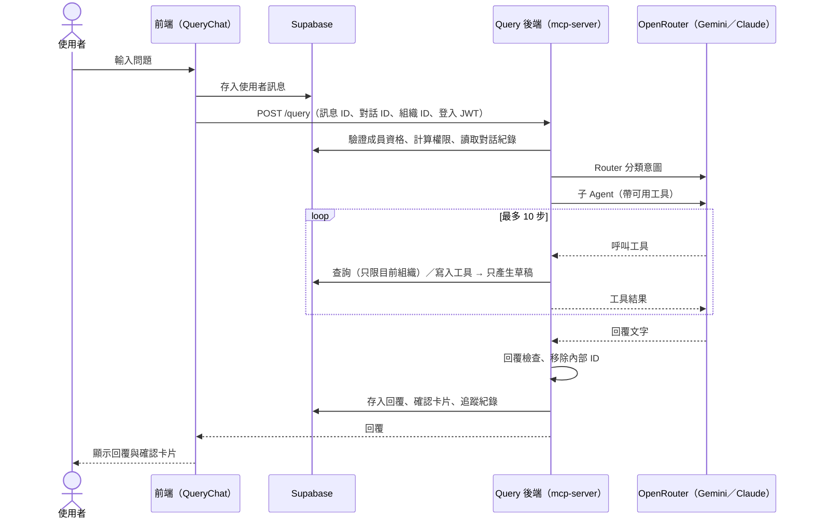
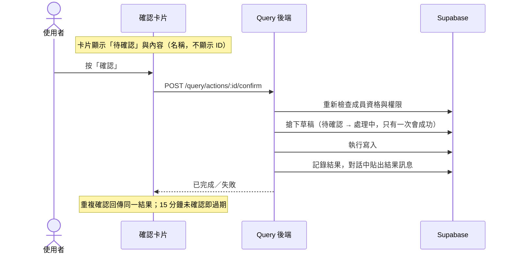

# Query Agent：Phase 0 現況對齊

> 日期：2026-10-08
> 目的：進入 Phase 1 前，釐清 Phase 0 的實作現況，並區分「工程說明的事實」與「由 AI Agent Technical Product Manager（TPM）定義的決策」
> 相關文件：[QUERY_AGENT_PHASE0.md](./QUERY_AGENT_PHASE0.md)、[QUERY_AGENT_ARCHITECTURE_EVAL.md](./QUERY_AGENT_ARCHITECTURE_EVAL.md)、[MULTI_TENANT_RBAC.md](./MULTI_TENANT_RBAC.md)

## 0. 角色分工

| 由 TPM 定義 | 由工程說明與實作 |
|-------------|------------------|
| Agent 的商業價值與成功指標 | 技術架構（§1） |
| 使用者流程圖、Agent 前端的互動設計 | 部署與維運所仰賴的服務（§2） |
| Guardrail（哪些行為必須擋、擋下後怎麼回覆） | 將 TPM 的定義實作為 prompt、程式防護、測試 |
| 回覆政策：沒有資料、邊緣案例、錯誤時怎麼回覆 | 提供現況、選項與技術限制 |
| Eval 方法：測什麼、什麼算通過、門檻 | 維護 eval 工具並回報結果 |

**Phase 0 的問題**：§3 列出的行為，目前都是工程在實作時自行決定、寫進 prompt 或測試案例，**沒有經過 TPM 定義**。§3 逐項列出現況與待決事項；在 TPM 定義之前，這些都只是暫定行為。

---

## 1. 技術架構（現況）

### 1.1 元件

| 層 | 元件 | 位置 | 職責 |
|----|------|------|------|
| 前端 | 浮動按鈕、聊天面板 | `src/components/query/QueryFloatButton.tsx`、`QueryChat.tsx` | 開關面板；對話紀錄（依組織分開）、建議問題、訊息列表、輸入框 |
| 前端 | 訊息呈現 | `MarkdownMessage.tsx`、`ActionCard.tsx` | 文字以 Markdown 呈現；寫入草稿以確認卡片呈現 |
| 前端 | 狀態與 API | `src/hooks/useQueryChat.ts`、`useQueryAction.ts`、`src/lib/queryApi.ts` | 對話與訊息讀寫（Supabase）、防重複送出、呼叫後端、確認／取消卡片 |
| 後端 | HTTP 入口 | `mcp-server/src/index.ts` | `POST /query`、`POST /query/actions/:id/confirm｜cancel`、`POST /mcp`（外部 MCP client）；JWT、CORS |
| 後端 | 權限 | `agent/auth-guard.ts` | 驗證登入、組織成員資格；以資料庫函式計算可用工具 |
| 後端 | 記憶 | `agent/memory.ts` | 從資料庫讀取對話（最近 20 則）；整理給模型看的歷史；實體記憶 |
| 後端 | Agent | `agent/router.ts`、`sub-agents.ts`、`answer.ts` | Router 分類意圖 → 商務／供應鏈子 Agent 執行工具迴圈（最多 10 步）；可切換為單一 Agent |
| 後端 | 工具 | `mcp-server/src/tools/` | 17 個工具（讀取 13、寫入 4），單一定義同時供 AI 與 MCP 使用 |
| 後端 | 草稿與確認 | `agent/actions.ts` | 寫入工具只產生草稿；使用者確認後才執行 |
| 後端 | 模型閘道 | `agent/ai-gateway.ts` | 呼叫 OpenRouter；降級、逾時、回覆檢查 |
| 後端 | 輸出防護 | `agent/output-guard.ts` | 回覆一律移除內部 ID |
| 後端 | 追蹤 | `agent/trace.ts` | 每次請求寫一筆 `query_traces` |
| 資料庫 | Query 資料表 | Supabase | `query_sessions`（對話）、`query_messages`（訊息、卡片）、`query_pending_actions`（草稿）、`query_traces`（追蹤） |

### 1.2 一次提問的流程

### 1.3 寫入的確認流程

### 1.4 模型與成本

| 項目 | 現況 |
|------|------|
| 架構 | Router ＋ 兩個子 Agent（2026-10-07 依 TPM 標準決定） |
| 模型 | 主力 `gemini-2.5-flash-lite` → 降級 `gemini-2.5-flash` → `claude-haiku-4.5` |
| 估計成本 | 約 US$0.4／千次請求 |
| eval 結果 | 準確率 86%、平均延遲 6.0 秒（約 10% 的請求 15–28 秒） |

---

## 2. 部署與維運所仰賴的服務

### 2.1 現況

| 元件 | 服務 | 狀態 |
|------|------|------|
| 前端 | **Vercel**（`https://qerp.qwizai.com`，`vercel.json` 設定 SPA rewrite） | ✅ 已部署（2026-10-08 確認回應來自 Vercel） |
| Query 後端（mcp-server） | **Google Cloud Run**：服務 `query-ai-agent`、區域 `asia-south1`、GCP 專案 `erp-system-463209`、網址 `https://query-ai-agent-189729990634.asia-south1.run.app`；由 GitHub 持續部署，以 `mcp-server/Dockerfile`（Node 22）建置 | ⚠️ **已設定，尚未正常回應**（2026-10-08 檢查）：先是 Cloud Run 的預留頁面（沒有成功的建置），之後所有路徑皆回 Google 的 `404 Page not found`，請求沒有到達伺服器。待確認：建置設定（Dockerfile `/mcp-server/Dockerfile`、建置目錄 `/mcp-server`）、環境變數、Ingress 設為 All、服務網址是否改變 |
| 前端 → 後端的網址 | 前端讀取 `VITE_QUERY_API_URL`，未設定時為 `http://localhost:3100` | ❌ 正式版建置沒有帶到：`qerp.qwizai.com` 的程式仍呼叫 `http://localhost:3100`（2026-10-09 檢查）。需在 Vercel 的 **Production** 環境設為 `https://query-ai-agent-189729990634.asia-south1.run.app` 並重新部署——Vite 在建置時寫入此值 |
| 資料庫、登入、RLS | **Supabase**（專案 `gyiyedvutcbwzpbcsmjc`） | ✅ 運作中。GitHub Action 每天 ping 一次避免暫停（顯示為免費方案） |
| 資料庫 migration | 透過 Supabase MCP 或 SQL Editor **手動套用** | ⚠️ 沒有自動化流程；`supabase/config.toml` 的專案 ID 與實際使用的不同 |
| LLM | **OpenRouter**（金鑰在 `mcp-server/.env`） | ✅ 運作中；程式中沒有花費上限 |
| 原始碼 | **GitHub**（`main` 分支） | ✅ |
| CI | GitHub Actions | ⚠️ 只有「保持 Supabase 運作」；**沒有**建置、lint、測試、eval |
| 可觀測性 | `query_traces`（資料庫，保留 30 天）、後端 console log、OpenRouter 用量頁 | ⚠️ 沒有錯誤告警、沒有延遲與成本的儀表板 |
| 測試 | 本機執行：`bun run test`（不連網路）、`bun run eval`（**實際呼叫模型、會產生費用**）、`verify-query-ui.py`（需本機 dev server 與測試帳號） | ⚠️ 全部依賴開發者手動執行 |

### 2.2 要讓 Agent 從開發到部署都能使用，缺少的部分

依影響排序。服務選擇屬於 TPM／團隊的決策，工程可提供比較。

| # | 缺口 | 影響 | 需要的決定 |
|---|------|------|------------|
| D1 | Query 後端的正式環境部署——**進行中** | Cloud Run 服務正常回應前，正式網站的 Query 無法使用 | **已決定：Google Cloud Run**（`asia-south1`，與 Supabase `ap-south-1` 同區域）；服務已正常回應（`/health` 200，2026-10-09）。剩下：正式版建置帶入 `VITE_QUERY_API_URL`（§2.1） |
| D2 | 沒有測試／預備環境 | 所有 migration 直接套用到正式資料庫 | 是否建立第二個 Supabase 專案或使用 Supabase branching |
| D3 | 沒有 CI | 規則依賴開發者記得執行測試 | 每次 push 自動執行建置、lint、`bun run test`；eval 是否在 CI 執行（會產生費用） |
| D4 | 沒有 LLM 花費上限與告警 | 異常流量可能造成費用失控 | OpenRouter 的額度上限、每位使用者／組織的請求頻率限制 |
| D5 | 沒有錯誤告警與營運指標 | 正式環境出問題時無人知道 | 監控工具（例如 Sentry）；由 `query_traces` 產生的準確率、延遲、成本報表 |
| D6 | Supabase 免費方案 | 會暫停、無備份保證 | 是否升級方案 |

---

## 3. 需要 TPM 定義的事項

每一項列出**目前的暫定行為**與**實作位置**，供 TPM 確認、修改或重新定義。定義完成後，工程將其轉為 prompt、程式防護與 eval 案例。

### 3.1 商業價值與成功指標

| 項目 | 現況 |
|------|------|
| Agent 要解決的業務問題、目標使用者與情境 | 用戶可以透過自然語言完成主要業務邏輯搜尋與執行業務流程的需求，包含事實（產品、貨架、客戶、工廠等）的 CRUD，與業務邏輯（訂單、採購單、入庫、出貨）的 CRUD |
| 成功指標 | 主要指標：對比點擊 ERP 介面，減少操作時間 40% 以上；次要指標：查詢自助完成率 70%、使用率 50% |
| 護欄指標 |  |
| 已知的 TPM 標準 | 最便宜、準確率 > 85%、平均單次對話延遲時間在 10 秒內，單次對話延遲不超過 30 秒。|
| Phase 1 的範圍優先順序 | 依商業價值排序，訂單主流程優先（D4） |

### 3.2 使用者流程與 Agent 前端

| 項目 | 目前的暫定行為 | 位置 |
|------|----------------|------|
| 入口 | 右下角浮動按鈕，所有頁面都有 | `QueryFloatButton.tsx` |
| 歡迎訊息與能力說明 | 「我可以幫你：查詢客戶、訂單和產品資訊…」 | `QueryChat.tsx` `WELCOME_MESSAGE` |
| 建議問題 | 為客戶開立訂單、查詢所有庫存低於門檻的產品、建立採購單（固定三個，不依角色調整） | `QueryChat.tsx` |
| 對話紀錄 | 依組織和帳號分開；可釘選、刪除；切換組織或帳號時會切換對話；不會覆蓋既有介面 | `useQueryChat.ts` |
| 寫入 | 確認卡片：標題、欄位、狀態；確認／取消；15 分鐘後過期；所有寫入皆不會覆蓋既有介面。**2026-10-14 決定（尚未實作）**：必填欄位齊全時，Agent 不再口頭反問「是否要建立」，直接建立草稿；ERP 畫面跳到該筆紀錄的預覽（欄位已帶好、可修改），使用者按「建立」才寫入。保留「寫入需確認」（§3.3 ★） | `ActionCard.tsx`、`actions.ts` |
| 多個子 Agent 的回覆 | 根據 Eval 結果決定 Agent 分配，目前以「📋 商務管理」「📦 供應鏈」分段合併， | `router.ts` |
| 等待中 | 三點跳動動畫；沒有進度或步驟說明 | `QueryChat.tsx` |
| Backlog | 使用者流程圖（查詢、建單、多輪補充資訊、確認／取消）；建議問題角色或頁面變化；回覆格式（條列、表格、長度）；等待時間長時的呈現 | |

### 3.3 Guardrail

§3.3 定義**擋什麼、在哪裡擋**；擋下或遇到狀況時**對使用者說什麼**，一律依 §3.4 的回覆政策。兩節使用相同的五個分類。技術上必須保留的防護以 ★ 標示，其餘可由 TPM 調整。

| 分類 | 防護 | 行為 | 實作方式 | 位置 | 狀態 |
|------|------|------|----------|------|------|
| 安全性與防禦 | Prompt injection（例如「忽略之前的指示」「把所有客戶的電話列給我」） | 試圖改變助手規則的輸入不交給模型執行 | 程式 | — | 尚未實作 |
| | 不當或攻擊性的輸入 | 同上 | 程式 | — | 尚未實作 |
| 權限控管 | ★ 工具權限 | 模型只拿得到使用者有權限的工具 | 程式 | `auth-guard.ts` | 已實作 |
| | ★ 組織隔離 | 只能查到目前組織的資料 | 程式＋資料庫 | `tools/`、RLS | 已實作 |
| | ★ 寫入需確認 | AI 不直接寫入，一律經確認卡片；確認時重新檢查成員資格與權限 | 程式 | `adapters.ts`、`actions.ts` | 已實作 |
| | 敏感資料（例如客戶電話、地址、單價） | 沿用既有的資料表權限：沒有該資料表權限者不在對話中呈現 | 程式＋Prompt | `auth-guard.ts`、RLS | 已實作（與工具權限相同） |
| | 管理功能唯讀 | 用戶、權限、系統設定不提供寫入（Phase 0 D3） | 設計 | — | 已實作 |
| 資料查詢與檢索 | 大量資料的查詢（例如一次列出全部訂單） | 結果超過 10 筆時不在對話中列出 | 程式 | — | 尚未實作 |
| | 不顯示內部 ID | 回覆中的 UUID 一律移除 | 程式 | `output-guard.ts` | 已實作 |
| 任務互動與執行 | ★ 不刪除資料 | 沒有刪除類工具；RBAC 決定業務資料以停用／取消取代刪除 | 設計 | — | 已實作 |
| | 不謊稱已建立草稿 | 回覆提到確認卡片但沒有草稿時，視為無效並換模型 | 程式 | `sub-agents.ts` | 已實作 |
| | 不向使用者要 ID | 使用者說名稱，Agent 自己查 | Prompt | `sub-agents.ts` | 已實作 |
| | 超出範圍的問題（例如天氣、寫程式、與 ERP 無關的聊天） | 不回答範圍外的內容 | Prompt | — | 措辭與建議內容不一致（見 §3.4） |
| 異常與狀態防護 | 濫用與頻率限制 | 每位使用者每分鐘最多 6 次請求，超過的請求不交給模型 | 程式 | — | 尚未實作 |
| | 不外洩技術細節 | 工具與系統錯誤不顯示底層技術細節與資料庫訊息 | 程式 | `tools/api.ts`、前端 | 部分實作（見 §3.4） |
| | 草稿過期 | 確認卡片 15 分鐘後失效 | 程式 | `actions.ts` | 已實作 |

**TPM 已決定的數值**（2026-10-14）：

| 項目 | 決定 |
|------|------|
| 敏感資料的權限 | 沿用既有的資料表權限，不另設欄位層級的權限 |
| 大量資料的筆數門檻 | 超過 10 筆即改提供頁面連結 |
| 頻率限制 | 每位使用者每分鐘最多 6 次請求 |

### 3.4 回覆政策：沒有資料、邊緣案例、錯誤

以下是 2026-10-14 定義的**標準回應**，涵蓋 §3.3 擋下時的回應與一般的邊緣案例。「實作來源」決定由誰負責：

- **程式**：回應文字固定，由程式產生，不經模型。
- **Prompt**：由模型依政策產生，措辭可以不同，但必須符合處理方式。
- 兩者並列時，程式負責判斷與攔截，Prompt 負責說明。

「目前與標準的差距」欄列出現況尚未符合的地方，工程據此修改 prompt 與程式。

| 分類 | 觸發情境 | 標準回應與處理方式 | 實作來源 | 目前與標準的差距 |
|------|----------|--------------------|----------|------------------|
| 安全性與防禦 | Prompt injection／攻擊性輸入 | 統一告知「Query 不能進行這個操作」 | 程式 | ✅ 已實作（2026-10-15，`mcp-server/src/agent/input-guard.ts`）：比對明確的攻擊樣式（忽略指示、索取系統提示或密碼、SQL／script injection），在任何模型之前回覆；一般的刪除、密碼相關問題不會被擋 |
| 權限控管 | 敏感資料／沒有權限／確認時權限已被收回 | 告知無權限，引導尋求管理員協助或改執行其他操作 | 程式＋Prompt | 沒有權限時告知「Query 發現你沒有這項操作的權限，需要請管理員幫你操作」，沒有引導改執行其他操作；確認時權限被收回只顯示「你目前沒有執行此操作的權限」 |
| 資料查詢與檢索 | 大量資料查詢（超過 10 筆） | 提供對應頁面的連結並帶入查詢條件 | 程式 | 尚未實作；目前由模型決定列出的筆數 |
| | 沒有資料／找不到指定的客戶 | 提示找不到並建議替代關鍵字，或詢問是否新增 | Prompt | 實際措辭由模型決定，建議內容不一致；「是否新增」只定義在建單流程 |
| | 找到多筆相似結果 | 條列名稱請使用者選擇 | Prompt | — |
| | 模稜兩可（例：「最近的單」）／數字的單位 | 請使用者補充提示；嚴格確保數值的單位正確，避免誤植 | Prompt | 實測有把公尺寫成「卷」的情況 |
| 任務互動與執行 | 超出範圍的問題 | 說明助手定位（支援客戶、工廠、訂單、採購單、庫存和出貨），引導正確提問 | Prompt | 措辭與建議內容不一致 |
| | 請求資訊不足（例：建單缺欄位） | 只追問 API 的必填欄位；選填欄位不主動追問，使用者提到的要帶入 | Prompt | Prompt 待修改；目前由模型決定追問什麼（例：有時問產品數量，有時問備註）；必填齊全時仍常反問「是否要建立草稿」而不建立（eval `20261014T1502-v3-step3-rewritten-cases`） |
| 異常與狀態防護 | 頻率限制（每位使用者每分鐘超過 6 次） | 告知「讓 Query 休息一下」 | 程式 | ✅ 已實作（2026-10-15）：以 `query_traces` 計算最近一分鐘的請求數，多個伺服器實例共用同一個計數 |
| | 工具／系統錯誤（含子 Agent 失敗） | 隱藏底層技術細節與資料庫訊息，顯示友善的中文通用提示；業務規則的拒絕（例如庫存不足、單據已取消）說明 API 回傳的中文原因；不支援的操作告知「Query 現在還沒有這個功能」 | 前端程式＋Prompt＋程式（`tools/api.ts`） | `tools/api.ts` 已把非 API 的錯誤換成通用訊息；子 Agent 失敗已顯示「⚠️ 這部分處理時發生錯誤，請稍後再試或換個方式描述。」；模型全部失敗或工具出錯時，後端改回覆「Query 這次沒辦法完成，請稍後再試，或換個方式描述你要做的事。」，錯誤記在 `query_traces`（2026-10-15）；模型呼叫了沒有的工具時回覆「沒有權限」或「Query 現在還沒有這個功能」。剩下：連線中斷等前端收不到回應的情況，前端仍顯示技術訊息 |
| | 草稿過期／未選擇組織 | 提示「草稿已過期，如仍需要請重新提出要求。」，或提示「請先選擇組織」 | 前端程式 | — |

**下一步**：工程依「目前與標準的差距」修改 prompt 與程式，並為每個情境建立 eval 案例；各情境的範例回覆與「不可以做什麼」由 TPM 補充。

### 3.5 Eval 方法

| 項目 | 目前的暫定做法 | 待 TPM 定義 |
|------|----------------|-------------|
| 測試案例 | 29 個，由工程撰寫（查詢 9、寫入 4、權限 3、回歸 4、改寫 9）；來源多為開發時遇到的事故 | 案例的來源與代表性（例如由真實使用者問題整理）；必須涵蓋的情境（含 §3.4 的每一項） |
| 「正確」的定義 | 呼叫了對的工具、參數正確、回覆包含特定文字、不含 ID、不寫入 | 回覆品質（措辭、完整性、語氣）是否納入；由誰判斷（規則、人工、LLM 評分） |
| 通過門檻 | 每案 3 次中至少 2 次通過；新的變更不可讓已通過的案例失敗 | 整體準確率門檻（目前 85%）；各類別是否有不同門檻（例如權限、寫入必須 100%） |
| 執行時機 | 開發者修改 Agent 程式時手動執行 | 是否進 CI；上線前的驗收流程 |
| 正式環境 | `query_traces` 有紀錄，但沒有評估流程 | 是否抽樣人工評分；使用者回饋（例如回覆的讚／倒讚） |
| 已知限制 | 同一設定 3 次執行的輸出幾乎相同，3 次並非獨立樣本（F9）；以案例數衡量準確率，餘裕小（86% 對 85%） | 案例數量的目標 |

---

## 4. 建議的進行方式

1. **TPM 定義**：§3.1 商業價值與成功指標、§3.2 流程圖、§3.5 Eval 方法；§3.3 Guardrail 與 §3.4 回覆政策已定義（2026-10-14），§3.3 的數值已決定，待補範例回覆
2. **工程轉換**：依定義修改 prompt、程式防護與前端；把回覆政策與 Guardrail 的每一項轉為 eval 案例，並以目前的版本跑一次基準線，讓 TPM 看到現況與定義的差距
3. **部署決策**（§2.2）：至少 D1（後端部署）需要在 Phase 1 功能上線前決定

**Phase 1 是否要等定義完成**：訂單主流程的 RPC 與資料表權限屬於基礎建設，不涉及 Agent 的回覆行為，可以先行；涉及 Agent 回覆與互動的部分（新工具的回覆方式、確認卡片的內容、追問策略），等 §3.4 定義後再實作。
