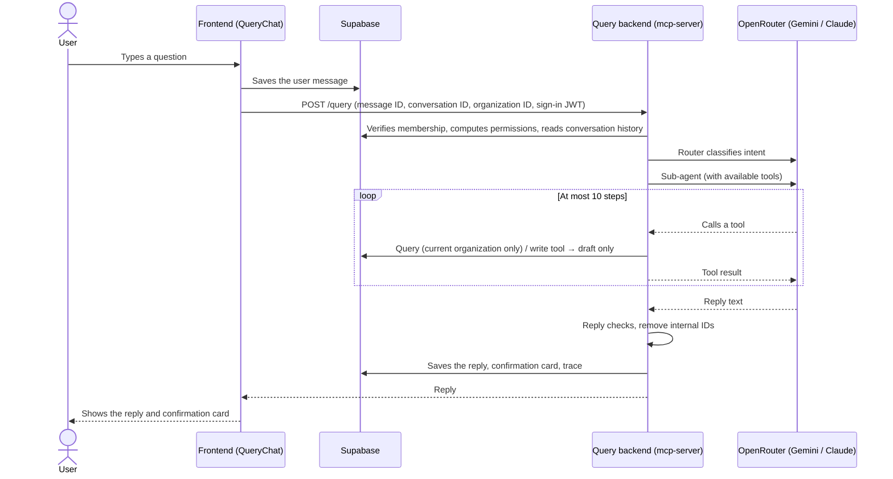

# Query Agent: Phase 0 State Alignment

> Date: 2026-10-08
> Purpose: before entering Phase 1, clarify the state of the Phase 0 implementation, and separate "facts explained by engineering" from "decisions defined by the AI Agent Technical Product Manager (TPM)"
> Related documents: [QUERY_AGENT_PHASE0.md](./QUERY_AGENT_PHASE0.md), [QUERY_AGENT_ARCHITECTURE_EVAL.md](./QUERY_AGENT_ARCHITECTURE_EVAL.md), [MULTI_TENANT_RBAC.md](./MULTI_TENANT_RBAC.md)

## 0. Roles

| Defined by the TPM | Explained and implemented by engineering |
|--------------------|------------------------------------------|
| The Agent's business value and success metrics | Technical architecture (§1) |
| User flow diagrams, interaction design of the Agent frontend | Services that deployment and operations depend on (§2) |
| Guardrails (which behaviors must be blocked, and how to reply once blocked) | Implementing the TPM's definitions as prompts, code safeguards and tests |
| Reply policy: how to reply when there's no data, in edge cases, on errors | Providing the current state, options and technical constraints |
| Eval method: what to test, what counts as passing, thresholds | Maintaining the eval tooling and reporting results |

**The Phase 0 problem**: the behaviors listed in §3 were all decided by engineering during implementation and written into prompts or test cases, **without being defined by the TPM**. §3 lists the current state and open questions item by item; until the TPM defines them, they are all provisional behavior.

---

## 1. Technical architecture (current state)

### 1.1 Components

| Layer | Component | Location | Responsibility |
|-------|-----------|----------|----------------|
| Frontend | Floating button, chat panel | `src/components/query/QueryFloatButton.tsx`, `QueryChat.tsx` | Opening/closing the panel; conversation history (separate per organization), suggested questions, message list, input box |
| Frontend | Message rendering | `MarkdownMessage.tsx`, `ActionCard.tsx` | Text rendered as Markdown; write drafts rendered as confirmation cards |
| Frontend | State and API | `src/hooks/useQueryChat.ts`, `useQueryAction.ts`, `src/lib/queryApi.ts` | Reading and writing conversations and messages (Supabase), duplicate-send prevention, calling the backend, confirming / cancelling cards |
| Backend | HTTP entry | `mcp-server/src/index.ts` | `POST /query`, `POST /query/actions/:id/confirm｜cancel`, `POST /mcp` (external MCP clients); JWT, CORS |
| Backend | Permissions | `agent/auth-guard.ts` | Verifies sign-in and organization membership; computes the available tools with a database function |
| Backend | Memory | `agent/memory.ts` | Reads the conversation from the database (latest 20 messages); prepares the history the model sees; entity memory |
| Backend | Agent | `agent/router.ts`, `sub-agents.ts`, `answer.ts` | The router classifies intent → the commercial / supply chain sub-agent runs the tool loop (at most 10 steps); can be switched to a single Agent |
| Backend | Tools | `mcp-server/src/tools/` | 17 tools (13 read, 4 write); one definition serves both the AI and MCP |
| Backend | Drafts and confirmation | `agent/actions.ts` | Write tools only produce drafts; they run after the user confirms |
| Backend | Model gateway | `agent/ai-gateway.ts` | Calls OpenRouter; fallbacks, timeouts, reply checks |
| Backend | Output guard | `agent/output-guard.ts` | Always removes internal IDs from replies |
| Backend | Tracing | `agent/trace.ts` | Writes one `query_traces` row per request |
| Database | Query tables | Supabase | `query_sessions` (conversations), `query_messages` (messages, cards), `query_pending_actions` (drafts), `query_traces` (traces) |

### 1.2 Flow of one question



### 1.3 Write confirmation flow

```mermaid
sequenceDiagram
    actor U as User
    participant FE as Confirmation card
    participant BE as Query backend
    participant DB as Supabase

    Note over FE: Card shows "pending" and the content (names, never IDs)
    U->>FE: Presses "Confirm"
    FE->>BE: POST /query/actions/:id/confirm
    BE->>DB: Re-checks membership and permission
    BE->>DB: Claims the draft (pending → processing; only one attempt succeeds)
    BE->>DB: Runs the write
    BE->>DB: Records the result and posts a result message in the conversation
    BE-->>FE: Done / failed
    Note over FE: Repeat confirmations return the same result; expires after 15 minutes unconfirmed
```

### 1.4 Models and cost

| Item | Current state |
|------|---------------|
| Architecture | Router + two sub-agents (decided 2026-10-07 by the TPM's criteria) |
| Models | Primary `gemini-2.5-flash-lite` → fallback `gemini-2.5-flash` → `claude-haiku-4.5` |
| Estimated cost | About US$0.4 per thousand requests |
| Eval result | Accuracy 86%, average latency 6.0 seconds (about 10% of requests take 15–28 seconds) |

---

## 2. Services that deployment and operations depend on

### 2.1 Current state

| Component | Service | Status |
|-----------|---------|--------|
| Frontend | **Vercel** (`https://qerp.qwizai.com`, SPA rewrite configured in `vercel.json`) | ✅ Deployed (confirmed on 2026-10-08 that responses come from Vercel) |
| Query backend (mcp-server) | **Google Cloud Run**: service `query-ai-agent`, region `asia-south1`, GCP project `erp-system-463209`, URL `https://query-ai-agent-189729990634.asia-south1.run.app`; continuously deployed from GitHub, built with `mcp-server/Dockerfile` (Node 22) | ⚠️ **Configured but not responding correctly yet** (checked 2026-10-08): first Cloud Run's placeholder page (no successful build), then every path returned Google's `404 Page not found`, with requests never reaching the server. To check: build settings (Dockerfile `/mcp-server/Dockerfile`, build directory `/mcp-server`), environment variables, Ingress set to All, whether the service URL changed |
| Frontend → backend URL | The frontend reads `VITE_QUERY_API_URL`, defaulting to `http://localhost:3100` when unset | ❌ Not carried into the production build: the code on `qerp.qwizai.com` still calls `http://localhost:3100` (checked 2026-10-09). It needs to be set to `https://query-ai-agent-189729990634.asia-south1.run.app` in Vercel's **Production** environment and redeployed — Vite writes this value at build time |
| Database, sign-in, RLS | **Supabase** (project `gyiyedvutcbwzpbcsmjc`) | ✅ Running. A GitHub Action pings it daily to avoid pausing (shown as the free plan) |
| Database migrations | **Applied manually** through Supabase MCP or the SQL Editor | ⚠️ No automated process; the project ID in `supabase/config.toml` differs from the one actually used |
| LLM | **OpenRouter** (key in `mcp-server/.env`) | ✅ Running; no spending cap in code |
| Source code | **GitHub** (`main` branch) | ✅ |
| CI | GitHub Actions | ⚠️ Only "keep Supabase active"; **no** build, lint, tests or eval |
| Observability | `query_traces` (database, kept 30 days), backend console logs, OpenRouter usage page | ⚠️ No error alerts, no dashboards for latency and cost |
| Tests | Run locally: `bun run test` (no network), `bun run eval` (**calls real models and costs money**), `verify-query-ui.py` (needs the local dev server and a test account) | ⚠️ All depend on developers running them by hand |

### 2.2 What's missing for the Agent to work from development through deployment

Ordered by impact. Choosing services is a TPM / team decision; engineering can provide comparisons.

| # | Gap | Impact | Decision needed |
|---|-----|--------|-----------------|
| D1 | Production deployment of the Query backend — **in progress** | Until the Cloud Run service responds correctly, Query doesn't work on the production site | **Decided: Google Cloud Run** (`asia-south1`, the same region as Supabase `ap-south-1`); the service now responds correctly (`/health` 200, 2026-10-09). Remaining: carry `VITE_QUERY_API_URL` into the production build (§2.1) |
| D2 | No test / staging environment | Every migration is applied straight to the production database | Whether to create a second Supabase project or use Supabase branching |
| D3 | No CI | The rules depend on developers remembering to run tests | Automatically run build, lint and `bun run test` on every push; whether the eval runs in CI (it costs money) |
| D4 | No LLM spending cap or alerts | Abnormal traffic could cause runaway costs | An OpenRouter credit limit; per-user / per-organization request rate limits |
| D5 | No error alerts or operational metrics | Nobody knows when production has a problem | A monitoring tool (e.g. Sentry); accuracy, latency and cost reports from `query_traces` |
| D6 | Supabase free plan | It pauses and has no backup guarantee | Whether to upgrade the plan |

---

## 3. Items for the TPM to define

Each item lists **the current provisional behavior** and **where it's implemented**, for the TPM to confirm, change or redefine. Once defined, engineering turns it into prompts, code safeguards and eval cases.

### 3.1 Business value and success metrics

| Item | Current state |
|------|---------------|
| The business problem the Agent solves, target users and situations | Users can use natural language to search the main business logic and run business processes, including CRUD on facts (products, shelves, customers, factories, etc.) and CRUD on business logic (orders, purchase orders, receiving, shipping) |
| Success metrics | Primary: cut operating time by 40% or more compared with clicking through the ERP UI; secondary: 70% self-service completion of queries, 50% usage |
| Guardrail metrics |  |
| Known TPM criteria | Cheapest, accuracy > 85%, average latency per conversation turn within 10 seconds, no single turn over 30 seconds. |
| Phase 1 scope priority | By business value, the main order flow first (D4) |

### 3.2 User flows and the Agent frontend

| Item | Current provisional behavior | Location |
|------|------------------------------|----------|
| Entry point | Floating button at the bottom right, on every page | `QueryFloatButton.tsx` |
| Welcome message and capabilities | 「我可以幫你：查詢客戶、訂單和產品資訊…」 (I can help you look up customer, order and product information…) | `QueryChat.tsx` `WELCOME_MESSAGE` |
| Suggested questions | Create an order for a customer, list all products below the stock threshold, create a purchase order (three fixed suggestions, not adjusted by role) | `QueryChat.tsx` |
| Conversation history | Separate per organization and account; can be pinned and deleted; switching organization or account switches conversations; never covers the existing UI | `useQueryChat.ts` |
| Writes | Confirmation card: title, fields, status; confirm / cancel; expires after 15 minutes; no write covers the existing UI. **Decided 2026-10-15 (replacing the 10-14 "jump to record preview")**: when all required fields are present, the Agent no longer asks verbally but creates the draft directly; after the user presses "Confirm" on the card and the write happens, the ERP switches to that record's page and opens it ([QUERY_UI_LAYOUT_AND_RECORD_NAV.md](./QUERY_UI_LAYOUT_AND_RECORD_NAV.md)). "Writes need confirmation" is kept (§3.3 ★) | `ActionCard.tsx`, `actions.ts` |
| Replies from several sub-agents | Agent allocation is decided by eval results; currently merged as sections 「📋 商務管理」「📦 供應鏈」 (commercial management, supply chain) | `router.ts` |
| Waiting | Three bouncing dots; no progress or step description | `QueryChat.tsx` |
| Backlog | User flow diagrams (query, order creation, multi-turn information gathering, confirm / cancel); suggested questions varying by role or page; reply format (lists, tables, length); presentation during long waits | |

### 3.3 Guardrails

§3.3 defines **what to block and where**; **what to say to the user** when blocked or when a situation arises always follows the §3.4 reply policy. Both sections use the same five categories. Safeguards that must be kept for technical reasons are marked ★; the rest can be adjusted by the TPM.

| Category | Safeguard | Behavior | Implemented by | Location | Status |
|----------|-----------|----------|----------------|----------|--------|
| Security and defense | Prompt injection (e.g. 「忽略之前的指示」 "ignore previous instructions", 「把所有客戶的電話列給我」 "list every customer's phone number") | Input that tries to change the assistant's rules is not passed to the model | Code | — | Not implemented yet |
| | Inappropriate or abusive input | Same as above | Code | — | Not implemented yet |
| Access control | ★ Tool permissions | The model only gets the tools the user has permission for | Code | `auth-guard.ts` | Implemented |
| | ★ Organization isolation | Only the current organization's data can be queried | Code + database | `tools/`, RLS | Implemented |
| | ★ Writes need confirmation | The AI never writes directly; always through a confirmation card; membership and permission are re-checked on confirmation | Code | `adapters.ts`, `actions.ts` | Implemented |
| | Sensitive data (e.g. customer phone, address, unit price) | Reuse the existing table permissions: people without permission on the table don't see it in the conversation | Code + prompt | `auth-guard.ts`, RLS | Implemented (same as tool permissions) |
| | Admin features read-only | No writes for users, permissions or system settings (Phase 0 D3) | Design | — | Implemented |
| Data query and retrieval | Large queries (e.g. listing every order at once) | Results over 10 rows are not listed in the conversation | Code | — | Not implemented yet |
| | No internal IDs shown | UUIDs are always removed from replies | Code | `output-guard.ts` | Implemented |
| Task interaction and execution | ★ No deleting data | No delete tools; RBAC decided business data is deactivated / cancelled instead of deleted | Design | — | Implemented |
| | No false claims of a draft | A reply that mentions a confirmation card without a draft is treated as invalid and the next model is tried | Code | `sub-agents.ts` | Implemented |
| | Never ask the user for IDs | The user gives a name and the Agent looks it up | Prompt | `sub-agents.ts` | Implemented |
| | Out-of-scope questions (e.g. weather, coding, chat unrelated to the ERP) | Don't answer out-of-scope content | Prompt | — | Wording and suggestions inconsistent (see §3.4) |
| Anomaly and state protection | Abuse and rate limiting | At most 6 requests per user per minute; requests over the limit aren't passed to the model | Code | — | Not implemented yet |
| | No leaking technical details | Tool and system errors don't show underlying technical details or database messages | Code | `tools/api.ts`, frontend | Partly implemented (see §3.4) |
| | Draft expiry | Confirmation cards expire after 15 minutes | Code | `actions.ts` | Implemented |

**Values decided by the TPM** (2026-10-14):

| Item | Decision |
|------|----------|
| Permissions for sensitive data | Reuse the existing table permissions; no separate column-level permissions |
| Row threshold for large results | Over 10 rows, provide a page link instead |
| Rate limit | At most 6 requests per user per minute |

### 3.4 Reply policy: no data, edge cases, errors

These are the **standard responses** defined on 2026-10-14, covering the responses when §3.3 blocks something and general edge cases. The "implemented by" column decides who is responsible:

- **Code**: the response text is fixed and produced by code, without the model.
- **Prompt**: produced by the model according to the policy; wording may vary but must follow the handling.
- When both are listed, code does the detection and interception, and the prompt does the explanation.

The "gap from the standard" column lists where the current state doesn't yet match, so engineering can change prompts and code accordingly.

| Category | Trigger | Standard response and handling | Implemented by | Gap from the standard |
|----------|---------|--------------------------------|----------------|-----------------------|
| Security and defense | Prompt injection / abusive input | Always reply 「Query 不能進行這個操作」 (Query can't do this) | Code | ✅ Implemented (2026-10-15, `mcp-server/src/agent/input-guard.ts`): matches explicit attack patterns (ignore instructions, requests for the system prompt or passwords, SQL / script injection) and replies before any model; ordinary questions about deleting or passwords are not blocked |
| Access control | Sensitive data / no permission / permission revoked by the time of confirmation | Say there's no permission and suggest asking an admin for help or doing something else | Code + prompt | Without permission it says 「Query 發現你沒有這項操作的權限，需要請管理員幫你操作」 (Query found you don't have permission for this; ask an admin to do it), without suggesting other actions; permission revoked at confirmation only shows 「你目前沒有執行此操作的權限」 (you currently don't have permission for this) |
| Data query and retrieval | Large queries (over 10 rows) | Provide a link to the matching page with the filters applied | Code | Not implemented yet; the model currently decides how many rows to list |
| | No data / specified customer not found | Say nothing was found and suggest alternative keywords, or ask whether to add it | Prompt | The wording is up to the model and the suggestions are inconsistent; "whether to add it" is only defined in the order-creation flow |
| | Several similar results | List the names for the user to choose | Prompt | — |
| | Ambiguous (e.g. 「最近的單」, "the recent order") / units of numbers | Ask the user for more hints; strictly ensure values have the right unit to avoid mistakes | Prompt | In testing, meters were written as 「卷」 (rolls) |
| Task interaction and execution | Out-of-scope questions | Explain what the assistant covers (customers, factories, orders, purchase orders, inventory and shipping) and guide toward a proper question | Prompt | Wording and suggestions inconsistent |
| | Not enough information (e.g. order creation missing fields) | Only ask for the API's required fields; don't proactively ask for optional fields, but include those the user mentions | Prompt | Prompt to be changed; the model currently decides what to ask (e.g. sometimes product quantity, sometimes the note); with all required fields present, it still often asks "should I create a draft?" instead of creating it (eval `20261014T1502-v3-step3-rewritten-cases`) |
| Anomaly and state protection | Rate limit (over 6 per user per minute) | Reply 「讓 Query 休息一下」 (let Query take a break) | Code | ✅ Implemented (2026-10-15): counts the last minute's requests from `query_traces`, so multiple server instances share one count |
| | Tool / system errors (including sub-agent failures) | Hide underlying technical details and database messages and show a friendly, generic Chinese message; for business-rule rejections (e.g. insufficient stock, document already cancelled) explain the Chinese reason returned by the API; for unsupported operations reply 「Query 現在還沒有這個功能」 (Query can't do this yet) | Frontend code + prompt + code (`tools/api.ts`) | `tools/api.ts` already replaces non-API errors with a generic message; sub-agent failures already show 「⚠️ 這部分處理時發生錯誤，請稍後再試或換個方式描述。」 (an error occurred on this part; try again later or describe it differently); when all models fail or a tool errors, the backend now replies 「Query 這次沒辦法完成，請稍後再試，或換個方式描述你要做的事。」 (Query couldn't finish this time; try again later or describe what you want differently) and records the error in `query_traces` (2026-10-15); when the model calls a tool it doesn't have, it replies "no permission" or "Query can't do this yet". Remaining: when the frontend gets no response (e.g. a dropped connection), it still shows a technical message |
| | Draft expired / no organization selected | Show 「草稿已過期，如仍需要請重新提出要求。」 (the draft expired; ask again if you still need it) or 「請先選擇組織」 (select an organization first) | Frontend code | — |

**Next step**: engineering changes prompts and code according to the "gap from the standard" and creates eval cases for each situation; the TPM adds example replies and "what not to do" for each situation.

### 3.5 Eval method

| Item | Current provisional approach | For the TPM to define |
|------|------------------------------|-----------------------|
| Test cases | 29, written by engineering (query 9, write 4, permission 3, regression 4, paraphrase 9); mostly from incidents during development | Where cases come from and how representative they are (e.g. compiled from real user questions); situations that must be covered (including every item in §3.4) |
| Definition of "correct" | The right tool was called, the parameters are correct, the reply contains specific text, contains no ID, writes nothing | Whether reply quality (wording, completeness, tone) counts; who judges (rules, humans, LLM scoring) |
| Pass threshold | At least 2 of 3 runs pass per case; a new change must not make a passing case fail | Overall accuracy threshold (currently 85%); whether categories have different thresholds (e.g. permission and write cases must be 100%) |
| When it runs | Manually, when a developer changes Agent code | Whether it goes into CI; the acceptance process before release |
| Production | `query_traces` has records, but there's no evaluation process | Whether to sample for human scoring; user feedback (e.g. thumbs up / down on replies) |
| Known limits | The 3 runs with the same settings produce nearly identical output, so they aren't independent samples (F9); accuracy is measured by number of cases, so the margin is small (86% vs 85%) | Target number of cases |

---

## 4. Suggested way forward

1. **TPM defines**: §3.1 business value and success metrics, §3.2 flow diagrams, §3.5 eval method; §3.3 guardrails and §3.4 reply policy are defined (2026-10-14), the §3.3 values are decided, and example replies are still to be added
2. **Engineering converts**: change prompts, code safeguards and the frontend according to the definitions; turn every reply policy and guardrail item into eval cases, and run a baseline with the current version so the TPM can see the gap between the current state and the definitions
3. **Deployment decisions** (§2.2): at least D1 (backend deployment) needs to be decided before Phase 1 features go live

**Should Phase 1 wait for the definitions?** The RPCs and table permissions for the main order flow are infrastructure and don't involve the Agent's reply behavior, so they can go first; the parts involving Agent replies and interaction (how new tools reply, confirmation card content, follow-up question strategy) are implemented after §3.4 is defined.
